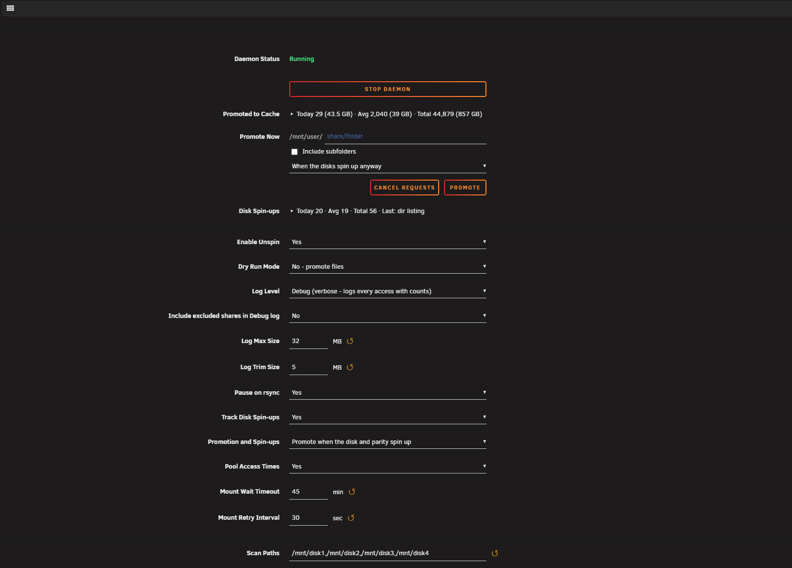
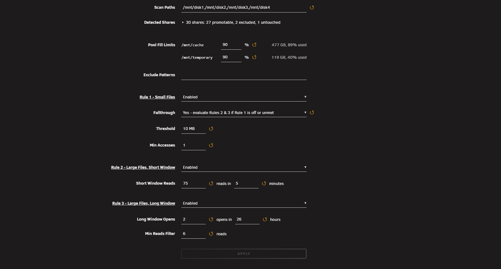
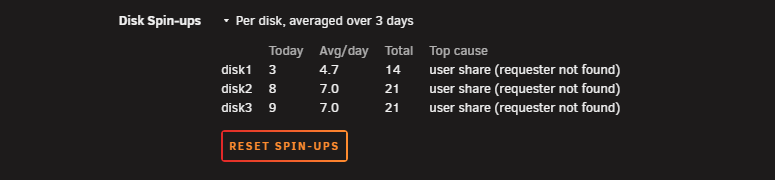
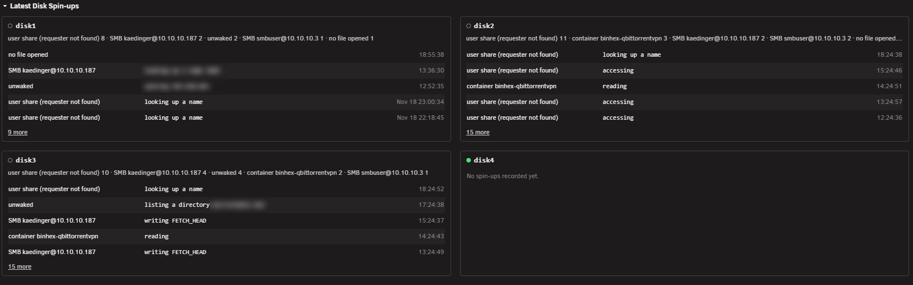
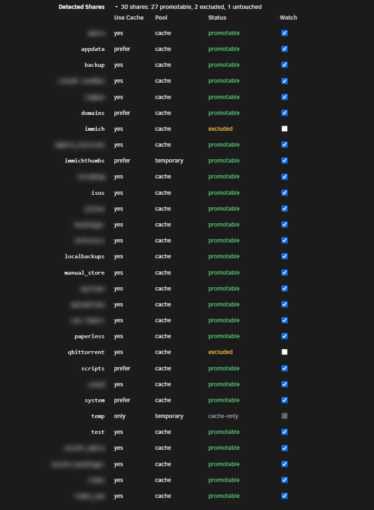
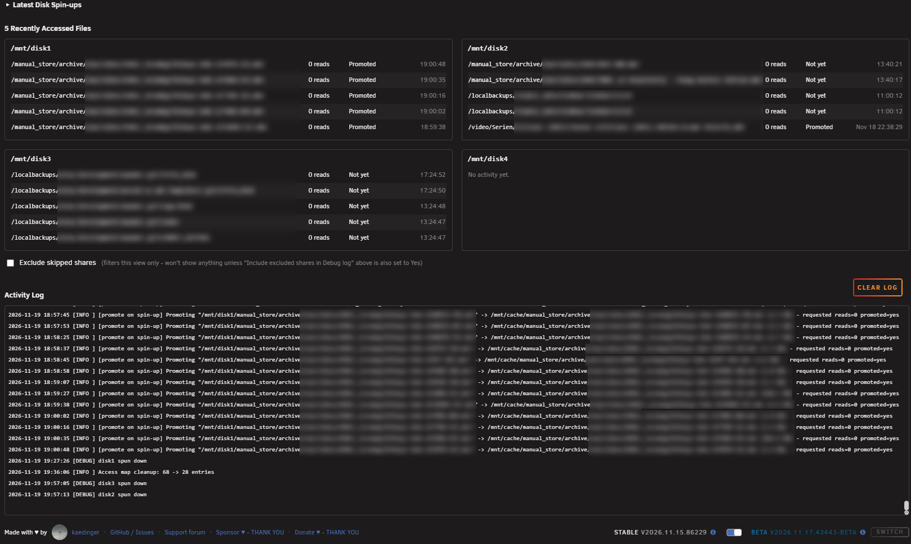

# Unspin - Rudimentary Hot-File Tiering for Unraid

Automatically promotes your most-accessed files to faster storage using a lightweight C++ daemon that watches file access. The main goal is to have fewer disk spin-ups (hence the name), but we'll take the faster access, too ;-)

<p align="center">
  
</p>

<p align="center">
  <a href="https://github.com/kaedinger/unspin/releases/latest"></a>
  <a href="https://github.com/kaedinger/unspin/releases"></a>
  <a href="https://github.com/kaedinger/unspin/releases"></a>
  <a href="https://github.com/kaedinger/unspin/releases"></a>
  <br>
  <a href="https://unraid.net/"></a>
  <a href="https://github.com/kaedinger/unspin/issues"></a>
  <a href="https://forums.unraid.net/topic/198091-plugin-unspin-rudimentary-hot-file-tiering-for-unraid/"></a>
</p>

---

## How It Works

Unspin runs `unspind`, a daemon that uses Linux's **fanotify** interface to receive a `FAN_*` events every time a file is opened or read. It applies three simple promotion rules:

| Rule | Condition | Example use case |
|---|---|---|
| **Small file** | `size ≤ threshold` AND `total reads ≥ min` | Promote a config file on first access |
| **Large file - short window** | `reads ≥ N` within last `M` minutes | Streaming video (100 reads in 5 min) |
| **Large file - long window** | `reads ≥ N` within last `H` hours | Frequently opened PDF (3 times in 24 h) |

A file meets rules 2 or 3 if either window threshold is satisfied.

**Why these rules?** Based just on the developer's use cases: Under ideal circumstances we would cache everything - but we don't have the space, we only have 512 GB. Thus, we have to select: we can't have a huge Linux ISO using up precious space if it's just held open for a few bytes of torrent upload. But of course that changes if it is being constantly read, or on a regular basis. A song played only once does not need to be promoted, but if we play it every day, it should be. You'll have to play around with the rule settings to best match your own use cases.

Make sure this does what you want! There's a dry-run mode; use it!

### Promotion timing

Promotion is always deferred until all open handles on the file are closed. Unlinking the source while a reader (SMB, NFS, local process) still holds an fd would cause the client to lose the file - shfs does not redirect to the cache copy mid-stream. By waiting for close, the next open transparently picks up the promoted copy.

Unspin never spins up a data disk. A file can be read from RAM while its disk is spun down, or the disk can spin down while a promotion waits (for the file to be closed, for the Mover or for a pause). By default the file is then marked and promoted as soon as its disk spins up for another reason; the marks survive a reboot. Marked files also wait for room when the pool is full, instead of being dropped. Unspin takes the spin state from Unraid and never touches a spun-down disk itself. Parity is different: a promotion removes the original from the array, which is a write, so a spun-down parity disk spins up for it. The setting Promotion and Spin-ups can wait for parity too, so a promotion spins up nothing at all, or skip such promotions. Every decision is logged.

There's no explicit cold demotion - for now we rely on Unraid's mover or CA's Mover Tuning.

---

## Features

- **Event-driven** - reacts to each file read in real time via fanotify on the underlying array disk mounts, no polling or cron schedule
- **Two-tier rule set** - separate thresholds for small files (first-access promotion) and large files (streaming/periodic use detection)
- **Deferred promotion** - promotion waits until all open handles are closed, so readers never lose their file mid-stream
- **Per-share cache pool routing** - destinations follow each share's own `shareCachePool` setting in Unraid, so different shares can promote to different pools (e.g. `/mnt/cache` for some, `/mnt/nvme` for others). Shares with `Use Cache: No` or `only` are skipped automatically; shares with `yes` or `prefer` are eligible.
- **Detected Shares table** - the settings page lists every share with its current routing and a per-share Watch toggle to opt individual shares out without changing Unraid's settings
- **Mover/rsync-aware** - Unraid's mover is always detected and pauses Unspin; other tools that move files via `rsync` (e.g. Unbalanced, or Mover Tuning) can optionally pause it too via `PAUSE_ON_RSYNC` - if you use Mover Tuning, make sure this is enabled!
- **Mount-wait on boot** - waits for slow-mounting arrays/pools before watching a scan path; posts an Unraid notification if it has to wait, and another if the wait times out
- **ZFS array disk support** - a top-level share on a ZFS-formatted array disk becomes its own dataset mount under the hood; Unspin detects and watches those automatically, both at startup and as new ones appear, so ZFS array disks work the same as XFS/Btrfs
- **Recently Accessed Files panel** - on debug logging, the settings page shows the last 5 accessed files per disk (read count, promoted state) plus skipped-share hits, scraped from the log itself
- **Disk spin-ups** - shows which program, container, VM or SMB client spun up a spun-down array disk, with counts per disk and cause and the latest spin-ups. Access through user shares (`shfs`) is traced back to the program that asked for the file. A read served from RAM doesn't spin up a disk and isn't counted; for a directory listing or a name lookup, the program waiting for the disk is shown with what it was doing, or "no file opened" if none was found; a change written out later without a file write (times, attributes, rename, delete) as "metadata change", told apart because XFS writes to the disk or parity spins up too; a command sent to the disk (spin-up, SMART) as "no I/O seen"
- **Promote now** - promote a folder of a user share (optionally with its subfolders) on request, from the settings page or `rc.unspin promote`: right away, or once its disks spin up anyway
- **Per-pool fill guard** - each pool gets its own fill % threshold; promotion to that pool stops once it's exceeded
- **Dry-run mode** - logs every decision without moving anything
- **Exclude patterns** - skip any path substring
- **Rule toggles** - each rule can be individually enabled or disabled from the settings page
- **Pause / unpause** - stackable pause locks via `rc.unspin pause <name>` / `unpause <name>` / `toggle`; daemon only resumes when all locks are released (useful for backup tool access)
- **Live log viewer** - auto-refreshing tail of the last 200 lines in the settings page

---

## Installation

### Via Community Applications (recommended)

1. Install the **Community Applications** plugin
2. Search for **Unspin**
3. Click Install

### Manual

```bash
plugin install https://github.com/kaedinger/unspin/releases/latest/download/unspin.plg
```

### Stable and beta channel

New features come out as betas first. The switch at the bottom right of the settings page shows the newest version on each channel and moves you between them:

- **Switch:** move the slider to the other channel and click **Switch**. A note tells you what changes, then the version from that channel is installed. From then on, the Plugins page offers you updates from that channel only.
- **Update:** when your own channel has a newer version, it's shown in red and the button turns into **Update**.
- **Every stable release reaches the beta channel too**, either under the same number or inside the next beta. Beta users never miss a fix.
- **Settings stay** when you switch. Going back to stable drops settings that only exist in the beta the next time you save; they come back with their defaults if you switch to beta again.
- **Community Applications:** on the beta channel, CA doesn't list Unspin under *Installed Apps*, because CA only recognizes the stable version. Unspin keeps working and updating as usual; manage it on the Plugins page.
- **Fix Common Problems** warns on the beta channel that Unspin is not known to Community Applications. Same reason: CA only knows the stable version. Nothing is wrong; you can ignore that warning.

To install the beta directly:

```bash
plugin install https://raw.githubusercontent.com/kaedinger/unspin/channel/unspin.plg
```

---

## Project Structure

```
unspin/
├── unspin.plg                          # Plugin manifest (install/remove)
├── src/
│   └── unspind.cpp                     # C++ fanotify daemon (compiled by CI)
├── etc/
│   └── rc.d/
│       └── rc.unspin                   # Service init script (start/stop/restart/status)
└── usr/
    └── local/
        ├── emhttp/plugins/unspin/
        │   ├── Unspin.page             # Unraid page registration
        │   ├── Unspin.php              # Settings UI (render)
        │   ├── include/
        │   │   ├── exec.php            # POST action handler (save/start/stop/etc.)
        │   │   ├── cfg.php             # Shared config/share-parsing helpers
        │   │   ├── channel.php         # Release channels: installed channel, newest versions
        │   │   └── log_scan.php        # Shared log-tail/scan helpers
        │   └── unspin.cfg.default      # Default config
        └── sbin/
            └── unspind                 # Compiled daemon binary (built by CI)
```

---

## Configuration Reference

| Key | Default | Description |
|---|---|---|
| `SERVICE` | `disabled` | `enabled` to start daemon automatically |
| `SCAN_PATHS` | `/mnt/disk1,/mnt/disk2` | Comma-separated **array disk** mount points to watch |
| `EXCLUDED_SHARES` | *(empty)* | Comma-separated share names to skip even when `shareUseCache` is `yes` or `prefer`. Managed by the Detected Shares table on the settings page. |
| `MAX_FILL_PERCENT_<pool>` | `80` | One entry per pool referenced by a watched share, e.g. `MAX_FILL_PERCENT_cache=80`. Promotion to that pool stops once its fill exceeds the threshold. |
| `SMALL_FILE_THRESHOLD` | `10 MB` | Files at or below this size use the small-file rule |
| `SMALL_MIN_ACCESSES` | `1` | Total reads required to promote a small file |
| `LARGE_SHORT_MIN_ACCESSES` | `100` | Reads required within the short window |
| `LARGE_SHORT_WINDOW_MINS` | `5` | Duration of the short window (minutes) |
| `LARGE_LONG_MIN_ACCESSES` | `3` | Opens required within the long window |
| `LARGE_LONG_WINDOW_HOURS` | `24` | Duration of the long window (hours) |
| `EXCLUDE_PATTERNS` | `/nevercachethis,/orthis` | Comma-separated path substrings to skip |
| `RULE1_ENABLED` | `yes` | Enable small-file rule |
| `RULE1_FALLTHROUGH` | `no` | Also evaluate large-file rules for small files when rule 1 is off or unmet |
| `RULE2_ENABLED` | `yes` | Enable large-file short-window rule |
| `RULE3_ENABLED` | `yes` | Enable large-file long-window rule |
| `RULE3_MIN_READS` | `5` | Thumbnail filter: skip opens with fewer reads than this (0 = disabled) |
| `PAUSE_ON_RSYNC` | `yes` | Also pause while any `rsync` process is running (covers tools like Unbalanced or Mover Tuning's rsync-based transfers). Unraid's mover itself is always detected regardless of this setting. |
| `TRACK_WAKEUPS` | `yes` | Log and count which program, container, VM or SMB client spins up a spun-down array disk; shown under Disk Spin-ups on the settings page. Keeps running while Unspin is paused. |
| `PROMOTE_ON_SPINUP` | `yes` | Promotion and Spin-ups: a rule fired while the file's disk was spun down. Promote the file once the disk spins up for another reason (`yes`), once the disk and parity both spin up (`parity`), or don't promote it (`no`): the file stays on the array unless a later access fires a rule again while its disk is spinning. |
| `ENABLE_POOL_ATIME` | `no` | Turn access times on for the pools Unspin promotes into, for Mover Tuning's "Use ATIME" filter (see below). Btrfs/XFS pools are remounted `relatime` (re-applied after every array start); ZFS datasets get `atime=on relatime=on` (untested). Switching it off only undoes Unspin's own changes, now or at the next array start. |
| `DRY_RUN` | `yes` | Log promotion decisions without moving files |
| `LOG_LEVEL` | `info` | `info` or `debug` |
| `LOG_EXCLUDED_SHARES` | `no` | On debug logging, also log skipped-share accesses (off by default so a noisy excluded share doesn't crowd out other shares' history) |
| `LOG_MAX_SIZE_MB` | `64` | Log is trimmed once it exceeds this size |
| `LOG_TRIM_SIZE_MB` | `5` | Size the log is trimmed down to (whole lines kept) |
| `MOUNT_WAIT_TIMEOUT_MINS` | `45` | Max minutes to wait for each scan path to mount at boot (0 = don't wait) |
| `MOUNT_RETRY_INTERVAL_SECS` | `30` | Seconds between mount re-checks while waiting |
| `COMPANION_LABEL` | `yes` | Not on the settings page. Show the name next to Unwake's icon in the pill at the top right of the settings page (`yes`), or the icon only (`no`). |
| `COMPANION_HINT` | `yes` | Not on the settings page. While Unwake isn't installed, the pill says that Unspin works best with Unwake and links to it (`yes`); `no` hides the pill instead. |

### Using Unspin with Mover Tuning

Unspin promotes files because they are read, so the natural way to demote them is Mover Tuning's age filter with **Use ATIME**: files go back to the array once they haven't been *accessed* for a while. Unraid mounts every pool with `noatime`, though, so access times never change on a read. Set `ENABLE_POOL_ATIME` to `yes` (Pool Access Times on the settings page) to fix that for the pools Unspin promotes into. Promoted files always get the promotion time as their access time, so they aren't demoted on Mover Tuning's next run.

---

## Service Control

```bash
/etc/rc.d/rc.unspin start
/etc/rc.d/rc.unspin stop
/etc/rc.d/rc.unspin restart
/etc/rc.d/rc.unspin status
/etc/rc.d/rc.unspin pause <name>    # add a pause lock (name required)
/etc/rc.d/rc.unspin pause <name> --ttl 15m   # pause lock that expires unless refreshed
/etc/rc.d/rc.unspin unpause <name>  # release a pause lock
/etc/rc.d/rc.unspin toggle [name]   # if paused: clear all locks; if running: pause with <name>
/etc/rc.d/rc.unspin promote /mnt/user/<share>/<path> [--recursive] [--now]   # promote a folder
/etc/rc.d/rc.unspin promote cancel  # drop requested promotions not done yet
```

Pause locks stack - the daemon only resumes when all locks are released.
Names must contain only letters, digits, dots, hyphens, and underscores.

```bash
rc.unspin pause borgbackup      # paused (1 lock)
rc.unspin pause rsnapshot       # still paused (2 locks)
rc.unspin unpause borgbackup    # still paused (1 lock)
rc.unspin unpause rsnapshot     # resumed (0 locks)
```

### Remote pause from backup scripts

Wrap your backup jobs with `pause` / `unpause` over SSH so Unspin doesn't count (or promote) files while they're being read by the backup tool:

```bash
ssh root@nas /etc/rc.d/rc.unspin pause borgbackup
borg create ssh://root@nas/mnt/disk1/backups::daily /data
ssh root@nas /etc/rc.d/rc.unspin unpause borgbackup
```

Because locks stack, multiple backup tools can pause independently without interfering with each other.

### Pause locks that expire

A lock normally stays until it's released, so if the job that set it dies (killed, crashed, or its VM stopped mid-run), Unspin stays paused until you run `unpause` or reboot. To avoid that, give the lock a time to live and refresh it while the job runs:

```bash
ssh root@nas /etc/rc.d/rc.unspin pause mybackup --ttl 15m
# ... during the job, every 5 minutes:
ssh root@nas /etc/rc.d/rc.unspin pause mybackup --ttl 15m
# ... at the end:
ssh root@nas /etc/rc.d/rc.unspin unpause mybackup
```

- Calling `pause` again with the same name refreshes the lock. The last call decides: `pause mybackup` without `--ttl` makes it permanent again.
- Times are a number with `s`, `m`, `h` or `d` (e.g. `90s`, `15m`, `2h`, `1d`).
- A lock not refreshed within its time is removed by Unspin and logged as `Pause lock expired - mybackup`.
- `rc.unspin status` shows how long each of these locks has left.

### Promote a folder on request

Promote the files of a folder without waiting for the rules, e.g. a series you're about to watch:

```bash
rc.unspin promote "/mnt/user/media/Series/Some Show/Season 2"               # once its disks spin up anyway
rc.unspin promote "/mnt/user/media/Series/Some Show" --recursive --now      # right away, with subfolders
rc.unspin promote cancel                                                    # drop what isn't done yet
```

- The path must be in a user share with a cache pool; the share doesn't have to be watched. Exclude Patterns still apply.
- Without `--now`, the folder is listed right away only on the disks that are up, and on a spun-down disk once it spins up for another reason. Each file then waits until its disk is up (and parity, if Promotion and Spin-ups waits for parity).
- With `--now`, the folder is listed on every array disk right away, and spun-down disks and parity spin up.
- Files are promoted one after another with the usual checks: the pool fill limit (files wait for space), open files, the Mover and pauses. Waiting files survive a reboot and are listed on the settings page under Promoted to Cache.

The daemon also accepts signals directly (no stacking):

```bash
kill -HUP    $(cat /var/run/unspind.pid)   # reload config
kill -TERM   $(cat /var/run/unspind.pid)   # graceful stop
kill -USR1   $(cat /var/run/unspind.pid)   # pause
kill -USR2   $(cat /var/run/unspind.pid)   # unpause
kill -RTMIN  $(cat /var/run/unspind.pid)   # toggle pause
kill -RTMIN+1 $(cat /var/run/unspind.pid)  # look for promote requests now (rc.unspin promote sends it)
```

---

## Daemon CLI

```bash
# Normal run (reads /boot/config/plugins/unspin/unspin.cfg)
/usr/local/sbin/unspind

# Dry run - no files moved
/usr/local/sbin/unspind --dry-run

# Verbose output
/usr/local/sbin/unspind --debug

# Custom config
/usr/local/sbin/unspind --config /path/to/unspin.cfg
```

---

## How Files Are Moved

When a file qualifies for promotion, Unspin

1. looks up the share's `shareCachePool` from `/boot/config/shares/<share>.cfg` and rebases the file path onto that pool (e.g. for share `media` with `shareCachePool=cache`, `/mnt/disk1/media/foo.mkv` -> `/mnt/cache/media/foo.mkv`),
2. copies the file to the pool, invisible until it is complete, with exactly the same permissions, owner and attributes (folders it creates on the pool get those of their array counterparts), as the Mover does,
3. swaps it in place of the array file only if nobody moved, changed, deleted or opened the file in the meantime.

A file is never lost, doubled, left half-copied or missing from the share: whatever you do with it during a promotion wins, and Unspin tries again on a later access. Even a crash in the middle of a promotion is recovered on the next start.


---

## Screenshots















---

## Requirements

- Unraid 7.0+ (probably even earlier, but I tested it with 7.2.3 onwards)
- Linux kernel 2.6.37+ with fanotify support (all Unraid kernels qualify)
- No external dependencies

---

## License

GPLv2. Contributions welcome - open an issue or PR on GitHub.

## History

Unspin started as a batch script a few years ago on my old Ubuntu machine Gregory (RIP), then turned into a C++ daemon for a proprietary project I did for a German car company (where it was called Hotfile and already using fanotify). As I started using Unraid this year and wanted to give something back to its fantastic community, I turned it into this plugin.

The idea and those origins are entirely human-made. The plugin grew from that daemon with Claude Code, and is tested on my own server.